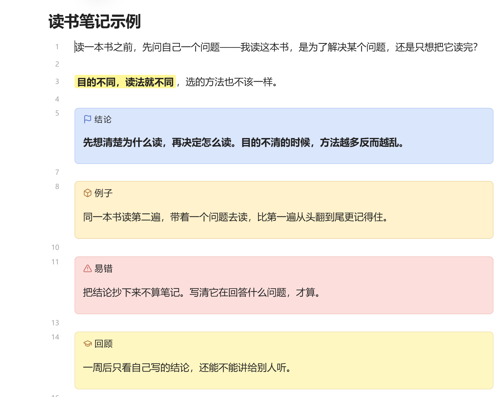
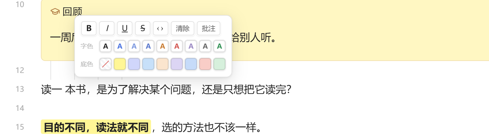
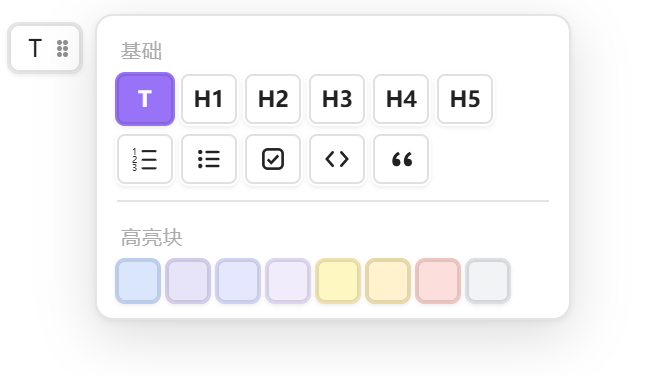

# FlyText

Obsidian 飞书式工具栏插件，用鼠标完成 Markdown 排版，不加载第三方依赖。仓库地址：[yevulq/obsidian-feishu-toolbar](https://github.com/yevulq/obsidian-feishu-toolbar)



## 功能

- **行内格式** — 选中文字后在选区旁弹出格式栏，含加粗、斜体、下划线、删除线、行内代码、8 种字色、8 种底色、清除与批注。
- **块类型** — 鼠标移到行号一列即可改动当前行块类型，覆盖正文、H1–H5、有序 / 无序 / 任务列表、代码块、引用与 8 种高亮块，空行也可直接建块。
- **批注** — 为选中文字挂批注并显示侧边卡片，数据写入文件末尾的 `%% ft-comments %%` 块，换设备同步不丢失。
- **纯 Markdown 写入** — 样式以 `<span class="hl-y fw-b">…</span>` 的类名记录，不写入内联色值。
- **零依赖** — 仅使用 Obsidian 自带 API 与内置 CodeMirror 6，无第三方依赖。

## 安装

当前版本 2.0.0，要求 Obsidian ≥ 1.5.0，仅桌面端（Windows / macOS / Linux）。

1. 从[最新 Release](https://github.com/yevulq/obsidian-feishu-toolbar/releases/latest) 下载 `main.js`、`manifest.json`、`styles.css` 三个文件。
2. 放入库目录下的插件文件夹 `<库>/.obsidian/plugins/feishu-toolbar/`。
3. 打开 Obsidian，在「设置 → 第三方插件」中关闭安全模式并刷新插件列表。
4. 启用「FlyText 飞书式工具栏」，重启 Obsidian 一次。

从 v1 升级时直接覆盖这三个文件，已有笔记无需改动。

## 使用

### 行内格式

选中文字（在高亮块内同样可以直接选中，无需切换到源码模式），格式栏贴在选区旁弹出。

- 面板保持打开，可连续执行加粗、斜体、下划线等操作。
- 点击面板以外区域关闭；右键仍交由 Obsidian 原生菜单处理。
- 色块悬停显示该颜色的用途；「清除」只清格式，保留批注标记。



### 块类型

鼠标移到行号一列，行首出现块按钮，平时不显示。按钮左侧显示当前块类型标识：T 正文、H1–H5 标题、• 无序列表、1. 有序列表、`</>` 代码块、” 引用、▣ 高亮块、☐ 任务清单。

- 点击按钮弹出块菜单：正文、H1–H5、有序、无序、任务、代码、引用、8 种高亮块。
- 空行同样有按钮，选择颜色后块直接建立，光标落在块内即可继续输入。
- 取消高亮块：在块菜单选择「T（正文）」，整块还原为普通段落。
- 菜单保持打开以便连续修改，按 `Esc` 关闭。
- 在相邻的非空内容行旁新建块时，插件补一个空行，避免下一行被并入块内。



### 批注

1. 选中文字，点击格式栏的「批注」。
2. 文字出现淡黄底加下划线标记，旁边弹出卡片：引用原文、输入框、保存 / 删除 / 关闭。
3. 点击该标记可重新打开卡片，内容保留。

批注数据写在文件末尾的 `%% ft-comments %%` 注释块中，不占用正文；删除该块即清空本文件全部批注。


## 命令

命令面板（`Ctrl/Cmd + P`）提供 5 条命令：

- 「块菜单：改当前行的块类型」
- 「加粗选中文字」
- 「高亮选中文字（例子黄）」
- 「清除选中文字的所有样式」
- 「FlyText: 诊断」

## 样式定制

插件不定义颜色，只使用 `var(--hl-y, #fff696)` 这类带默认值的变量。在库的 CSS snippet 中重定义变量即可全局生效：`--hl-y` 例子黄、`--hl-g` 主题靛、`--hl-b` 定义蓝、`--hl-n` 类比橙、`--hl-o` 辨析紫、`--hl-c` 警告青、`--hl-r` 警告红、`--hl-m` 提示绿。

## 数据格式与兼容性

写入文件的内容为纯 Markdown，文件编码为 UTF-8 纯文本 `.md`，样式以类名记录：

```html
<span class="hl-y fw-b">这段文字有黄色底色，同时加粗</span>
```

颜色与字重各占一个类，互不嵌套。链接、图片、行内代码、公式等原子片段不会被 `span` 切断；块级前缀（`>`、`#`、`-`、`[!note]`）不包裹 `span`。

在 Obsidian 之外打开或卸载插件后：`span` 样式退化为纯文字；Obsidian 扩展语法的 callout 在 GitHub 上仅 `note` / `tip` / `important` / `warning` / `caution` 有效，其余退化为普通引用；`%% ft-comments %%` 在其他阅读器中可能显示为正文。

## 已知限制

- 表格行与围栏代码块内的行不提供块按钮，避免破坏结构。
- Live Preview 将多行 callout 折叠为一个渲染块，中间部分源码行不显示行号；插件按源码绝对行号定位，不影响操作。
- 笔记内独立的 `---` 由 Obsidian 渲染为原生分隔线，不是插件绘制。
- 块按钮右侧的六个点为视觉对齐元素，暂不支持拖拽排序。
- 点击批注标记的瞬间该行会临时显示源码（Live Preview 限制），关闭卡片后恢复。
- `.callout` 的样式带 `!important`，会统一全库所有 callout 的外观；若只需插件创建的块生效，删除 `styles.css` 中对应规则。
- 插件 CSS 类名统一带 `.ft-` 前缀，不影响其他插件的选择器。

## 开发

- `core.js`：纯逻辑（`scanLine` / `renderCells` / `parseBlock`），不依赖 Obsidian 与 DOM。
- `main.js`：`core.js` 内联后的成品，Obsidian 实际加载的文件。
- `build.js`：将 `core.js` 内联进 `main.js`。
- `test-core.js`：Node 单元测试，`node test-core.js` 共 76 项用例。
- 修改 `core.js` 后运行 `node build.js` 重建 `main.js`。
- 运行时日志写入 `<库>/.obsidian/feishu-toolbar.log`。

## 许可证

[MIT](LICENSE)
